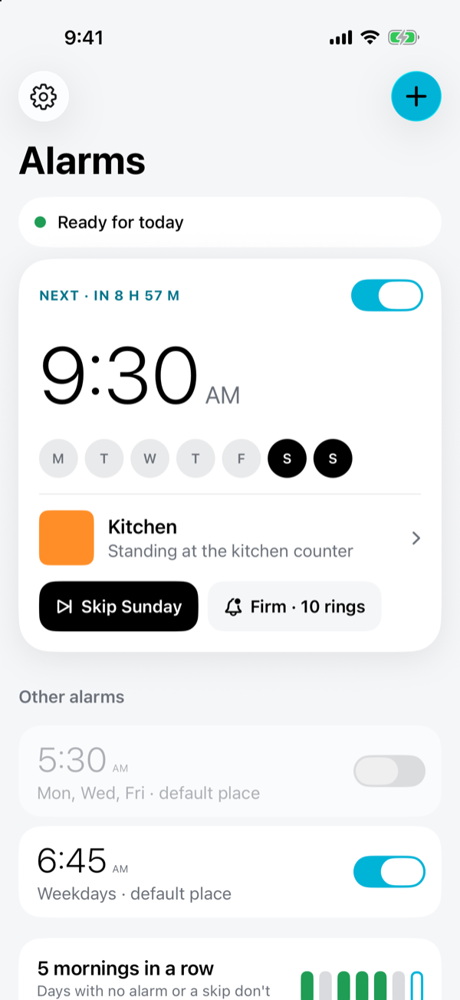
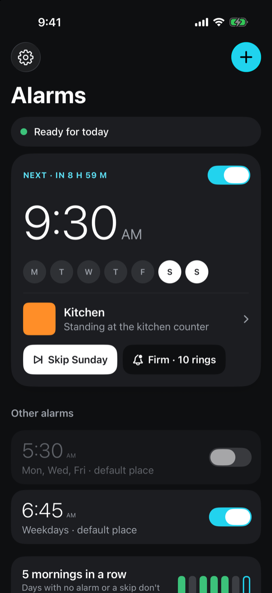
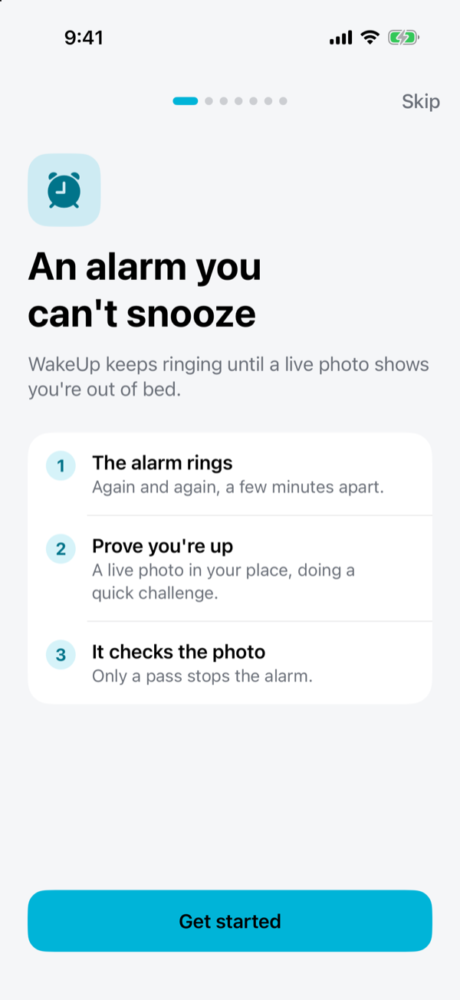
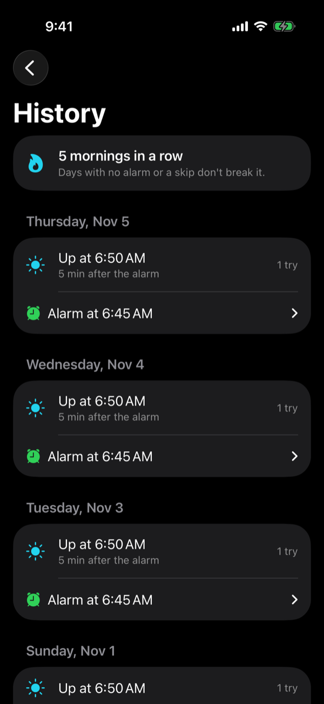
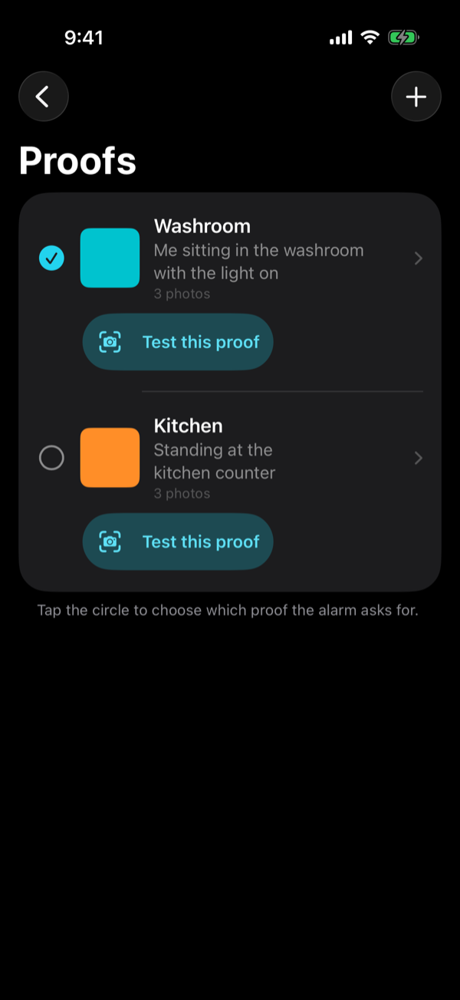
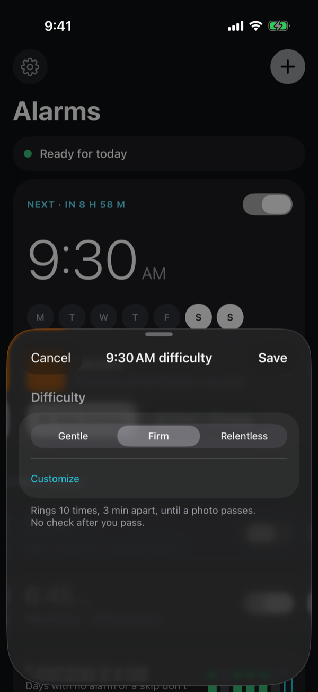
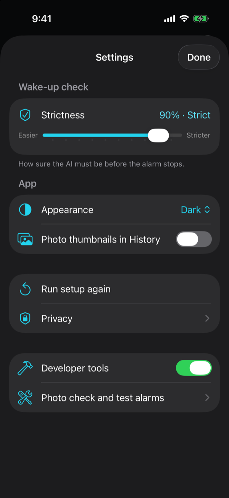

# WakeUp

An iPhone alarm that keeps ringing until you prove you're out of bed.

You describe what "up" looks like (for example, *me sitting in the washroom with the light on*) and save a few reference photos of that place. When the alarm goes off, you take a live photo with a random challenge, like "hold up 3 fingers". An AI vision model checks the photo against your description and reference photos. The alarm only stops for good when the check passes.

## Screenshots

| Home | Home (dark) | First-run setup |
|:---:|:---:|:---:|
|  |  |  |

| History | Proofs | Difficulty | Settings |
|:---:|:---:|:---:|:---:|
|  |  |  |  |

Simulator screenshots from a debug build with `-WakeUpSampleData` sample data.

## Status

The full plan for every phase, with open checks and risks, is in [PLAN.md](PLAN.md).

| Phase | What | State |
|---|---|---|
| 0 | Xcode project, signing | Done |
| 1 | AlarmKit alarm chain and "Prove I'm up" button | Built and tested in the simulator; the "Prove I'm up" button still needs testing on a real iPhone |
| 2 | Proofs: description and reference photos | Done, tested in the simulator |
| 3 | Live camera and the OpenAI check (Decisions API) | Built; unit tested; flow tested in the simulator with a mock verdict. Needs a real run with your key on the phone |
| 4 | Real morning alarms: repeating days and the follow-up check | Built and unit tested; not yet tried on the phone |
| 5 | Accuracy, offline backup and history | Built and unit tested; `eval/` needs your photos |
| 6 | Polish and first-run setup | Built (no widget) |
| 7 | Optional: sharing it with other people | Proxy, in-app service option and docs done; shipping needs the paid developer program |
| R | Redesign: Next Up home and Bedside wake screen | Built and unit tested; looked at in the simulator. Needs a real morning on the phone (see [docs/REDESIGN.md](docs/REDESIGN.md)) |

## The home and wake screens

**Alarms** (home) leads with one **Next Up** card: the alarm that rings next, a countdown, its days, its place, a **Skip** chip (greyed out, with the reason, when skipping isn't allowed) and a difficulty chip. Above it a single status pill says "Ready for tomorrow" or shows the worst problem with a button that fixes it ("+2" opens the full list). Below are the other alarms and a strip of the last seven mornings that opens History.

**Difficulty** (in the alarm editor, or on its own from the card's difficulty chip) is Gentle, Firm or Relentless: how many rings and how far apart. None of the presets adds a follow-up check; **Customize** can (Custom appears when the numbers match no preset).

The **wake screen** is full white whatever the system appearance: "Ring 2 of 10", the challenge in huge black type, one **Open camera** button, and a small "Not yet" with the time of the next ring. Screen brightness goes to full while it's up and is put back after. Reference photos are behind **Show photos**.

Debug builds accept the launch argument `-WakeUpSampleData` to fill an empty app with two places, three alarms and some history, so these screens can be checked in the simulator.

## How the alarm works

AlarmKit always shows a Stop button that apps can't remove. So a wake-up is a **chain** of alarms a few minutes apart (for example 7:00, 7:03, 7:06 …). They're all scheduled ahead of time, because the app might not be running when the first one rings.

- **Stop** silences the current ring. The next one still comes, and a notification says when.
- On the **last ring**, Stop brings it straight back (about 5 seconds later), again and again, until a photo passes.
- **Prove I'm up** silences the current ring and opens the proof screen.
- **Passing the check** cancels the rest of the chain.

Opening the app yourself while a chain is going also takes you to the proof screen.

## Proofs (phase 2)

A proof is what the AI checks your morning photo against:

- **Name**, like "Washroom"
- **Description** in your own words, like "Me sitting in the washroom with the light on"
- **3 to 5 reference photos** of the place, from the photo library

Photos are shrunk to 1024 px on the long side (about 200–400 KB each) and stored on the phone with SwiftData. You can keep several proofs; the filled circle in the list marks the one the alarm uses. The wake screen shows where to go, your description and the reference photos under the day's challenge.

Tested in the simulator: the editor won't save until all three parts are there and says what's missing; adding, removing and saving photos works; the proof survives an app restart and shows on the home and wake screens.

## The AI check (phase 3)

On the wake screen, **Take proof photo** opens a camera that can only take a new photo (front camera by default, with a flip button). The photo, your reference photos, your description and the day's challenge go to OpenAI, which judges six checks:

| Check | Pass when |
|---|---|
| `same_place` | it's the place in your reference photos |
| `person_present` | you're in the photo |
| `matches_description` | it shows what your description says |
| `challenge_completed` | you're doing today's challenge |
| `appears_awake` | you look up: eyes open, upright, not in bed |
| `looks_like_photo_of_screen_or_print` | this one must be **unlikely** |

The app, not the AI, decides pass or fail: **every** check must reach your strictness, a slider in Settings from 50% to 95% (70% is normal). A pass stops the chain; a fail lists the checks that missed.

### Which OpenAI API

Settings › Developer tools › **AI check** chooses between:

- **Decisions API** (default). `POST /v1/decisions` with one `predicate` question per check; it returns the probability of each. Uses `gpt-6-luna`, the only model it supports. Only input tokens are billed (about $0.10 per million), and OpenAI says it's much faster than the Responses API. It doesn't write a reason, so the result screen lists which checks failed.
- **Responses API**. `POST /v1/responses` with a strict JSON schema. The AI answers yes/no per check plus one overall confidence, and writes a short reason. Slower and pricier; you can pick the model.

Both sit behind the `WakeVerifier` protocol, so another model can be swapped in later.

The OpenAI API key goes in during setup or in Settings › Developer tools (saved in the Keychain on this phone only). **Test this proof** (under each proof) shows what the AI says without touching any alarms. If there's no proof or no API key, the wake screen offers **Stop alarms without proof**, so a setup problem can't trap you.

### Testing without a key

Debug builds can fake the AI's answer. In Xcode: **Product > Scheme > Edit Scheme > Run > Arguments**, add `-WakeUpMockVerdict pass` (or `fail`). Release builds ignore it.

The simulator has no camera, so simulator builds show a library photo button instead. Phone builds never offer the library on the wake screen.

### Tests

**Product > Test** (⌘U) runs the unit tests: the per-check pass rules, both verifiers' request bodies (Decisions predicates; Responses JSON schema), reply parsing (refusals, missing answers, cut-off answers, HTTP errors) against a stubbed network, and photo resizing.

## Alarms, follow-up and skipping (phase 4)

Add alarms on the home screen: a time, the days, an optional proof, how many times it re-rings and a follow-up delay. The app schedules each alarm's chain for the next few mornings and tops them up whenever it opens, after each pass and in a nightly background refresh, so it rings even on days you don't open it. If an alarm has a follow-up (Customize › Check again after), **Still up?** rings once more after that delay with a different challenge. **Skip** (next to an alarm) skips the next morning; it must be done the day before, and at most 2 skips are allowed in any 7 days. A developer switch in Settings shows test alarms and what's scheduled.

## History, offline backup and accuracy (phase 5)

- **History** lists each morning's checks: the alarm time, when you were up and how long after, and how many tries it took. The streak goes by what happened: a morning whose alarm rang out without a pass breaks it, while days with no alarm, skips and alarms you turned off don't, so changing alarms later never rewrites it. Developer-tools test runs aren't recorded. Photos aren't kept; an optional 200 px thumbnail can be.
- **Offline backup:** if OpenAI can't be reached after a retry (20 s timeout), a check on the phone with Apple's Vision looks for a face and the right place. It's weaker, so it's labelled "Checked offline" and a follow-up always comes.
- **Per-check thresholds:** strictness sets the base; the place check is held 5 points higher (never above 97%) and the awake check 10 lower.
- **`eval/`:** `python3 eval/run_eval.py` scores labelled photos; see [eval/README.md](eval/README.md).

## Setup, polish and sharing (phases 6 and 7)

First launch walks through permissions, how photos are checked, a first proof (reference photos can be taken with the camera), a practice run and a first alarm. The home screen warns about blocked alarms, a low battery, Low Power Mode and a development build about to expire. There's an app icon, a loud alarm sound option and a warning before deleting a proof an alarm uses.

To let other people use it without their own key, deploy [proxy/](proxy/README.md) and choose **Check with > WakeUp service** in Settings. Photos are only sent after the user agrees to a notice, and **On this phone only** sends nothing. Drafts for the App Store are in [docs/](docs/).

## Requirements

- iPhone on **iOS 26.1 or later** (AlarmKit)
- Xcode 26 or later (built with Xcode 27.2)

## Run it on your iPhone

1. Open `WakeUp.xcodeproj` in Xcode.
2. Plug in your iPhone and pick it as the run destination.
3. Under **Signing & Capabilities**, the team is set to your Personal Team. If Xcode complains about the bundle ID, change `com.nikhildhillon.WakeUp` to something unique.
4. Press Run. The first time, on the iPhone go to **Settings > General > VPN & Device Management**, trust your developer certificate, then turn on **Developer Mode** if asked.

With a free Apple ID, the app stops opening after 7 days. Run it from Xcode again to reinstall it.

## Phase 1 test on the phone

1. Open the app and tap **Allow alarms**.
2. Under **Quick test**, tap **Ring in 1 minute** (3 alarms, 1 minute apart).
3. Lock the phone and wait.
4. When it rings, tap **Prove I'm up**. Check that:
   - the app opens on the **Prove you're up** screen
   - tapping **Not yet** and waiting brings the next alarm a minute later
   - tapping **Test: count as passed** stops the rest of the chain
5. Try it once with the ringer switch on silent too.

If tapping **Prove I'm up** doesn't open the app, open WakeUp yourself while the chain is going. It goes straight to the proof screen.

### What the simulator showed (iOS 26.5, Nov 5 2026)

| Check | Result |
|---|---|
| Alarm permission prompt shows the WakeUp message | Works |
| Chain of 3 alarms, 1 minute apart, each rings on time | Works |
| Alarm shows "Time to prove you're up" with a camera button and the system X | Works |
| Opening the app while a chain is going shows the proof screen | Works |
| "Test: count as passed" stops the ringing alarm and cancels the rest of the chain | Works |
| Tapping the camera button ("Prove I'm up") opens the app | **Not working in the simulator.** iOS reports `Could not find an intent with identifier ProveAwakeIntent`. The likely cause is that simulator builds aren't signed with a team (`Unable to get teamId`), so iOS won't share the intent's details with the app. Phone builds are signed with your team, so this needs checking on the phone. |

## Project layout

```
WakeUp/
  WakeUpApp.swift          App entry, shows the proof screen when needed
  Alarm/
    AlarmService.swift     Schedules and cancels the alarm chain (AlarmKit)
    ChainStore.swift       Remembers which alarms belong to the current chain
    ProveAwakeIntent.swift The "Prove I'm up" alarm button
    RingStoppedIntent.swift The Stop button: next-ring note, or ring the last one again
    RingNotice.swift       The "Next ring at…" notification and ring titles
    WakeAlarmMetadata.swift
  Wake/
    WakeCoordinator.swift  When to show the proof screen, what passing does
    Challenge.swift        Random challenges ("hold up 3 fingers" …)
  Mission/
    Mission.swift          Proof model (name, description, reference photos)
    ActiveMission.swift    Which proof the alarm uses
    ImageResizer.swift     Shrinks photos to 1024 px JPEGs
  Verify/
    WakeVerifier.swift     Verifier protocol, errors, mock verifier, which one to use
    DecisionsVerifier.swift  Decisions API: one predicate per check (default)
    ResponsesVerifier.swift  Responses API: JSON answer plus a written reason
    OpenAIHTTP.swift       Shared request sending and error handling
    VerifierPrompt.swift   Questions, instructions and JSON schema sent to the AI
    Verdict.swift          Probability per check and the pass/fail rules
  Camera/
    CameraModel.swift      Live camera (no photo library)
    CameraPreview.swift
  Settings/
    HomeStatus.swift       What the status pill says; Next Up card logic
    KeychainStore.swift    API key storage
    AppSettings.swift      Model, strictness slider, key access
  Views/
    Theme.swift            Colours (from Assets.xcassets), sizes and shared styles
    HomeView.swift         Alarms screen: status pill, Next Up card, other alarms, week strip
    StatusPill.swift       The pill and its details sheet
    NextAlarmCard.swift    The Next Up card
    AlarmRowCompact.swift  A row for each of the other alarms
    DayDots.swift          Weekday circles (tappable on the Next Up card)
    WeekStrip.swift        Streak and the last seven mornings
    SettingsView.swift     Strictness slider, appearance, privacy
    PhotoCheckSettings.swift  Check method, OpenAI key, offline backup (Developer tools)
    DifficultySheet.swift  Difficulty presets, in the editor or on their own
    OnboardingView.swift   First-run setup
    ProofCaptureView.swift Camera, check, result
    MissionsView.swift     List of proofs; pick the one the alarm uses
    MissionEditorView.swift  Create or edit a proof
    WakeView.swift         The Bedside wake screen
Config/Info.plist          Permission messages (alarms, camera, photos)
```

## API keys

The OpenAI key is typed into the app (setup, or Settings › Developer tools) and kept in the iPhone Keychain (this device only). It's never committed to this repo. Photos are sent to OpenAI only during a check, with `store: false`.
