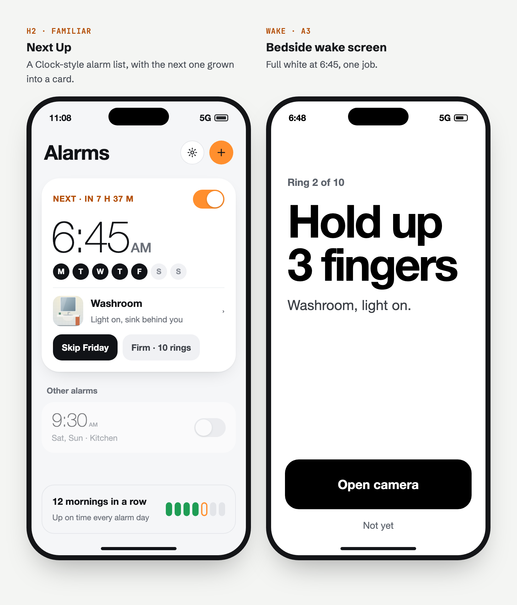

# WakeUp redesign: Next Up home and Bedside wake screen

_Written November 6, 2026._



The target: the **Next Up** home screen (left) and the **Bedside** wake screen (right). The mockups use sample data (a 6:45 weekday alarm, the Washroom place) and a drawn stand-in for the reference photo. They're HTML rebuilt from the Swift views, not simulator screenshots, so treat sizes as close but not exact. Where this plan and the mockup disagree, follow the plan.

The full design review, with the audit and the other directions considered, is on a private page: [WakeUp Redesign Directions](https://claude.ai/artifact/PmLLyDLAxM7uTKsUPSYHWh). The home options are under "New home screens" and the wake screen under "More takes on A" (A3, Bedside).

## What this changes

| Area | Today | After |
|---|---|---|
| Home | A grouped `List`: permission, Heads up, Alarms, Default proof, History, errors | An "Alarms" screen with one **Next Up** card, a status pill, the other alarms, and a week strip |
| Warnings | Orange text rows, all the same weight, no fix buttons | One **status pill**: "Ready for tomorrow", or the worst problem with a button that fixes it |
| Skip | A small bordered button in each row; an alert after a refused skip | A "Skip Friday" chip on the card that is greyed out, with the reason, before you tap |
| Ringing settings | Two steppers and a picker | **Gentle / Firm / Relentless** presets, with the steppers under Custom |
| Wake screen | Title, symbol, grey card with photos, "Not yet" as big as the main button | Full white, a huge black challenge, one black **Open camera** button, a small "Not yet" |

**What doesn't change:** the SwiftData models (no migration), scheduling (`SchedulePlanner`, `AlarmService`), the wake state machine (`WakeCoordinator`), verification, the camera and result screens (`ProofCaptureView`), Settings, onboarding, and the system alarm alert (AlarmKit owns it).

## Design rules

Put these in one file, `WakeUp/Views/Theme.swift`, plus colour sets in `Assets.xcassets`, so no view hard-codes a value.

**Colour** (each set has a dark appearance):

| Name | Light | Dark | Use |
|---|---|---|---|
| `Ground` | `#F5F6F8` | `#0E0F11` | Screen background |
| `Card` | `#FFFFFF` | `#1C1D21` | Next Up card, alarm rows |
| `InkSecondary` | `#6B7079` | `#9BA0A8` | Subtitles, captions (4.6:1 on Ground) |
| `AccentColor` | `#FF8F2E` | `#FF8F2E` | Toggles, + button, fills with dark text on them |
| `AccentText` | `#B4500A` | `#FFA45C` | Orange **text** ("NEXT · IN 7 H 37 M"); the fill orange fails contrast as text |
| `Ready` | `#1F9D55` | `#3CC27A` | Ready dot, passed days. Shapes only, never text (3.2:1 is enough for graphics, not for words) |
| `Warn` | `#B54708` | `#FDB022` | Status pill when something needs fixing |

The wake screen ignores all of these: pure `#FFFFFF` and `#000000` in light mode regardless of the system setting. That flash of white is part of the design.

**Type:** SF Pro only, no bundled fonts.
- Alarm time on the card: `.system(size: 70, weight: .light)` through `@ScaledMetric(relativeTo: .largeTitle)`, digits `.monospacedDigit()`. "AM" at 30% of that size in `InkSecondary`.
- Times in the other rows: 30 pt light, scaled the same way.
- Wake challenge: 72 pt heavy, scaled, `lineLimit(3)`, `minimumScaleFactor(0.6)`.
- Everything else uses text styles (`.headline`, `.subheadline`, `.footnote`) so Dynamic Type works.

**Shape and spacing:** 16 pt screen margins. Next Up card: 28 pt continuous corners, 18 pt padding, a soft shadow. Alarm rows: 20 pt corners. Chips: 14 pt corners, at least 44 pt tall. Nothing else gets a box.

## Screen specs

### Home

Mockup: the left screen in [h2-home-and-a3-wake.png](redesign/h2-home-and-a3-wake.png). Two parts come from other options in [home-options.png](redesign/home-options.png):
- the status pill is from H1 ("Ready for tomorrow");
- the "in 7 h 37 m" countdown on the card is also from H1.

The H2 mockup doesn't include the pill. Put it between the title and the card.

Keep `NavigationStack` with a large "Alarms" title and toolbar buttons (gear on the left of +, + filled orange). iOS 26 gives the glass toolbar and the scroll-edge behaviour for free.

Use a `List` with `.listStyle(.plain)`, hidden separators and custom row backgrounds rather than a `ScrollView`, so swipe-to-delete and `.refreshable` keep working.

From top to bottom:

1. **Status pill** (`StatusPill`)
   - Built from `HealthCheck.warnings(_:)` plus `alarmService.lastError` and `alarmService.authorization`.
   - No problems and an alarm on: a green dot and "Ready for tomorrow" (or "Ready for Monday" when the next ring isn't tomorrow).
   - Problems: the most severe one, as a short title and an action. If there are more, a "+2" badge, and tapping opens a sheet listing all of them with their full current messages.
   - Severity order, short titles and actions:

     | Warning | Pill text | Action |
     |---|---|---|
     | `alarmService.lastError` | "Couldn't schedule alarms" | Retry (`syncAlarms`) |
     | `.alarmsBlocked` | "Alarms are off for WakeUp" | Open Settings (`UIApplication.openSettingsURLString`) |
     | `.cameraDenied` | "Camera is blocked" | Open Settings |
     | `.noProof` | "Choose a place" | Open the proof editor |
     | `.cannotCheckPhoto` | "Photo check isn't set up" | Open the app's Settings sheet |
     | `.lowBattery` | "Battery low, plug in tonight" | None |
     | `.buildExpiring` | "Build expires in 2 days" | None |
     | `.lowPowerMode` | "Low Power Mode is on" | Opens the sheet with the full explanation |
     | not determined | "Allow alarms" | `requestAuthorization()` |
   - Hidden when there are no alarms at all; the empty state covers that.

2. **Next Up card** (`NextAlarmCard`)
   - Shows the enabled alarm with the earliest `SchedulePlanner.nextRing`.
   - Row 1: "NEXT · IN 7 H 37 M" in `AccentText`, caps, in a `TimelineView(.periodic(from: .now, by: 60))`. More than 24 hours away: "NEXT · MON". The alarm's toggle sits on the right.
   - The time, then the day dots: a read-only version of `WeekdayPicker`'s circles in the user's week order. At accessibility text sizes, swap them for `WakeAlarm.summary(of:)` ("Weekdays").
   - The place row: `MissionThumbnail` at 48 pt, the proof name, the description on one line, and a chevron. Links to `MissionsView`. With no ready proof it reads "Choose a place" and links to the editor.
   - Chips:
     - **Skip Friday** / **Undo skip**, using today's `toggleSkip` logic. When `SkipPolicy.check` would refuse, show the chip disabled with a caption ("2 skips used this week" or "Skip by the night before"). The alert stays only as a fallback.
     - **Firm · 10 rings**, which opens the editor.
   - Tapping the time opens the editor too.
   - VoiceOver: one element, "Next alarm, 6:45 AM, weekdays, in 7 hours 37 minutes, Washroom", with custom actions for Skip, Edit and the toggle.

3. **Other alarms**
   - A small "Other alarms" header, then one row per remaining alarm: the time at 30 pt light, then "Sat, Sun · Kitchen" (days · proof name, or "default place"), then a toggle.
   - Rows for alarms that are off are drawn at 55% opacity. Swipe to delete.

4. **Mornings strip** (`WeekStrip`)
   - "12 mornings in a row", a short line under it, and 7 small bars for the last 7 days.
   - Bar colours: passed is `Ready`, today still to come is an orange outline, a missed alarm day is `Warn`, a day with no alarm or a skip is grey.
   - Links to `HistoryView`.

**Empty and edge states:**
- No alarms: the card becomes "Set your first alarm" with a big + button. Keep today's copy: "Set the time and the days once…".
- Every alarm off: the card shows the first alarm greyed out, labelled "OFF". The pill says "No alarm is on".
- Next alarm skipped: the card shows the next real ring, with an "Undo skip" chip for the skipped day.

### Alarm editor

Add a **Difficulty** segmented control under Repeat:
- Gentle: 5 rings, 5 min apart, no follow-up
- Firm: 10 rings, 3 min apart, follow-up after 12 min
- Relentless: 10 rings, 2 min apart, follow-up after 10 min

"Custom" appears when the values match none of these, and it reveals today's two steppers and the follow-up picker. `WakeAlarm.chainLengthRange` is `1...10`, so Relentless can't add rings; it rings closer together.

The presets are a label worked out from the existing fields, so **no model change**.

### Wake screen

Mockup: the right screen in [h2-home-and-a3-wake.png](redesign/h2-home-and-a3-wake.png). Two differences from the mockup:
- the mockup has no "Show photos" button;
- the mockup's "Not yet" doesn't show the next ring time.

The spec below adds both.

`WakeView`, restyled:
- `.preferredColorScheme(.light)` on the full-screen cover, a white background and black text.
- Top: "Ring 2 of 10" in `.headline` grey (or "Still up?" for the follow-up chain).
- Then the challenge, huge, and under it the place name and the first line of its description ("Washroom, light on.").
- Reference photos move behind a small "Show photos" button. The big challenge is the point, but the photos still help you frame the shot.
- Bottom, in the safe-area inset: a black **Open camera** button at least 64 pt tall across the full width, and under it plain "Not yet" text with "Next ring at 6:51".
- Setup problems keep today's honest **Stop alarms without proof**, styled as a secondary outlined button.
- Raise screen brightness to full on appear (`windowScene.screen.brightness`) and restore the previous value on disappear.

The ring number and next-ring time come from a pure helper on `ScheduledChain`:

```swift
/// Which ring is current (1-based) and when the next one comes, from the chain's start and interval.
func ringPosition(at now: Date) -> (current: Int, total: Int, next: Date?)
```

`current` is `floor((now − start) / interval) + 1`, clamped to `1...slotIDs.count`. `next` is `nil` on the last ring.

## Build order

Each step ends with the app building and the unit tests passing.

| # | Step | Files | Done when | Days |
|---|---|---|---|---|
| 1 | Design tokens | `Theme.swift`, colour sets in `Assets.xcassets` | Colours and sizes come from one place; dark appearances set | 0.5 |
| 2 | Pure logic and tests | `HomeStatus.swift` (pill model from warnings), `AlarmDifficulty.swift`, `HistoryMath.recentDays(...)`, `ScheduledChain.ringPosition(at:)`, `SkipPolicy` "skips used" helper, `RedesignTests.swift` | Severity order, preset matching, week marks, ring position and skip captions are unit tested, including DST and week-boundary cases | 1 |
| 3 | Home components with previews | `NextAlarmCard.swift`, `StatusPill.swift`, `AlarmRowCompact.swift`, `WeekStrip.swift`, `DayDots.swift` | Each has `#Preview`s for normal, empty, off, skipped, warning and AX5 text sizes | 1.5 |
| 4 | Assemble Home | `HomeView.swift` | The old sections are gone; sheets, `.task`, `.onChange` syncing and `toggleSkip` behave as before | 1 |
| 5 | Difficulty presets | `AlarmEditorView.swift` | Picking a preset sets the three fields; odd values show Custom | 0.5 |
| 6 | Wake screen | `WakeView.swift` | White, ring counter, next-ring time, photos behind a button, brightness raised and restored | 1 |
| 7 | Quality pass | all of the above | Light and dark; text sizes up to AX5; VoiceOver on Home and Wake; Reduce Transparency; iPhone SE size (375 × 667) | 1 |
| 8 | Phone test and docs | `README.md`, `PLAN.md` | A real morning on the phone using the Phase 4 test; README describes the new home | 0.5 |

**About 7 working days.**

### Testing in the simulator

- Use the Developer view's test alarms and `-WakeUpMockVerdict pass` (or `fail`) to reach the wake screen and the result without a key or a camera.
- Previews cover most states. For the status pill, add a preview-only initializer that takes a `[HealthWarning]` so every row of the table above can be checked.

## Left out on purpose

These came up in the review and are worth doing later, but not in this change:
- Renaming "proofs" to "places" across the app, and a Places tab.
- The camera ghost overlay from direction B.
- The Mornings chart from direction C.
- Restyling onboarding, Settings and the proof result screen. The result screen should get plain-language fail reasons in place of percentages.
- Lock Screen widgets. The Next Up card is designed so it can become one.

## Open questions

- **Several alarms on the same morning** (6:30 and 6:45): the earliest one wins the card. Is that right, or should both show?
- **The forced-white wake screen ignores dark mode.** That's intended. If it turns out to be too harsh in a dark room, add a "Gentler wake screen" switch rather than following the system setting.
- **Brightness:** iOS keeps a changed brightness until the screen locks. If the app is killed while the wake screen is up, the phone stays at full brightness. That's acceptable; just note it in the phone test.
